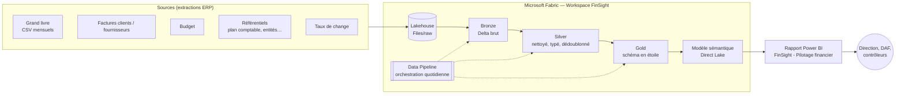

# FinSight — Plateforme d'analyse financière sur Microsoft Fabric & Power BI

> Projet de bout en bout (A → Z) : ingestion des données comptables d'un groupe multi-entités,
> architecture Lakehouse en médaillon (Bronze / Silver / Gold), modèle sémantique Direct Lake
> et rapports Power BI de pilotage financier (P&L, Budget vs Réel, Créances, Trésorerie).

---

## 1. Le contexte métier

**Groupe Novaris** (entreprise fictive) est un groupe de services B2B composé de 4 filiales :

| Code entité | Pays | Devise | Activité |
|---|---|---|---|
| NOV-FR | France | EUR | Siège + conseil |
| NOV-BE | Belgique | EUR | Conseil |
| NOV-UK | Royaume-Uni | GBP | Logiciel (SaaS) |
| NOV-MA | Maroc | MAD | Centre de services partagés |

Aujourd'hui, le contrôle de gestion consolide **à la main dans Excel** les extractions de l'ERP de chaque
filiale. Le reporting mensuel prend **8 jours ouvrés** après la clôture, les chiffres diffèrent selon
qui les produit, et la direction n'a aucune visibilité sur le DSO ou la trésorerie en cours de mois.

**Objectif du projet** : livrer une plateforme unique, automatisée et gouvernée dans Microsoft Fabric,
qui produit un reporting financier fiable **à J+1** de chaque clôture.

👉 Détails : [docs/01-cadrage.md](docs/01-cadrage.md)

## 2. L'architecture

👉 Détails : [docs/02-architecture.md](docs/02-architecture.md)

## 3. Contenu du dépôt

| Dossier | Contenu |
|---|---|
| [`docs/`](docs/) | Cadrage, architecture, modèle de données, guide pas-à-pas, dictionnaire des KPI, gouvernance, journal de bord |
| [`data/generator/`](data/generator/) | Générateur Python (bibliothèque standard uniquement) de données financières réalistes et cohérentes |
| [`data/raw/`](data/raw/) | Jeu de données généré, prêt à charger dans le Lakehouse |
| [`fabric/`](fabric/) | Notebooks PySpark au format Git Fabric (Bronze, Silver, Gold, qualité), pipeline, scripts SQL |
| [`powerbi/`](powerbi/) | Mesures DAX, spécification du modèle sémantique, maquette du rapport, sécurité RLS, thème |
| [`tests/`](tests/) | Tests automatisés de cohérence des données (écritures équilibrées, etc.) |
| [`BACKLOG.md`](BACKLOG.md) | **Toutes les tâches du projet**, par sprint, avec critères d'acceptation |

## 4. Démarrer

1. Lire le [cadrage](docs/01-cadrage.md) puis le [BACKLOG](BACKLOG.md).
2. (Optionnel) Régénérer les données : `python3 data/generator/generate_finance_data.py`
3. Suivre le **[guide d'implémentation pas-à-pas](docs/04-guide-implementation.md)** dans votre tenant Fabric
   (capacité d'essai Fabric gratuite de 60 jours suffisante).

## 5. Indicateurs livrés

Chiffre d'affaires · Marge brute · EBITDA · Résultat net · Budget & écarts · YTD / N-1 ·
DSO · DPO · Balance âgée · Encours clients · Trésorerie — voir le [dictionnaire des KPI](docs/05-dictionnaire-kpi.md).

## 6. Avancement

Le suivi détaillé est dans [BACKLOG.md](BACKLOG.md) et le [journal de bord](docs/journal.md).
