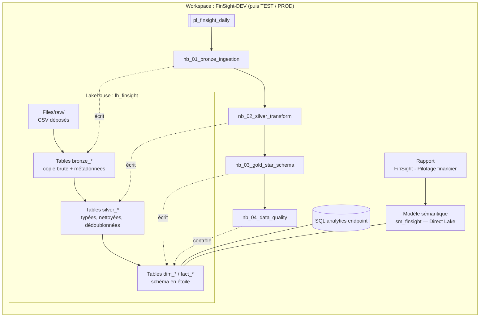
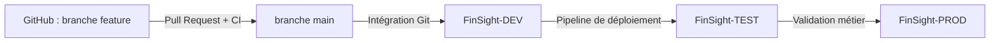

# 02 — Architecture technique

## 1. Vue d'ensemble

Architecture **Lakehouse en médaillon** dans un seul workspace Fabric par environnement.

## 2. Choix techniques et justification

| Décision | Choix | Pourquoi |
|---|---|---|
| Stockage | **Lakehouse** (pas Warehouse) | Transformations en PySpark, fichiers + tables dans un seul item, Direct Lake natif |
| Format | **Delta Lake** (V-Order activé par défaut) | ACID, time travel, lecture Direct Lake optimale |
| Transformation | **Notebooks PySpark** | Logique versionnée dans Git, testable, réutilisable |
| Orchestration | **Data Pipeline** Fabric | Planification, enchaînement, gestion d'erreurs, alertes |
| Mode de stockage Power BI | **Direct Lake** | Performances proches de l'Import sans rafraîchissement de données dupliquées |
| Versioning | **Intégration Git Fabric** (GitHub) | Traçabilité, revue de code, CI |
| Déploiement | **Pipelines de déploiement** Dev → Test → Prod | Séparation des environnements |

## 3. Conventions de nommage

| Élément | Convention | Exemple |
|---|---|---|
| Workspace | `FinSight-<ENV>` | `FinSight-DEV` |
| Lakehouse | `lh_<projet>` | `lh_finsight` |
| Notebook | `nb_<ordre>_<couche>_<rôle>` | `nb_02_silver_transform` |
| Pipeline | `pl_<projet>_<fréquence>` | `pl_finsight_daily` |
| Modèle sémantique | `sm_<projet>` | `sm_finsight` |
| Tables Bronze | `bronze_<source>` | `bronze_ecritures_gl` |
| Tables Silver | `silver_<entité>` | `silver_ecritures_gl` |
| Tables Gold | `dim_<axe>` / `fact_<processus>` | `dim_compte`, `fact_gl` |
| Colonnes | `snake_case`, français | `montant_eur`, `date_comptable` |
| Mesures DAX | Libellé métier en français | `CA`, `EBITDA %`, `DSO (jours)` |

## 4. Rôle de chaque couche

### Bronze — « ce que la source a envoyé »
- Lecture des CSV de `Files/raw/` **sans transformation métier** (tout en `string`).
- Ajout de colonnes techniques : `_source_file`, `_ingestion_ts`, `_batch_id`.
- Mode `append` pour le grand livre (un fichier par mois) avec idempotence par `_source_file`,
  `overwrite` pour les référentiels.

### Silver — « des données fiables »
- Typage (dates, décimaux), `trim`, normalisation des codes.
- Dédoublonnage (des doublons sont volontairement présents dans les sources).
- Valeurs manquantes : centre de coûts vide → `NON_AFFECTE`.
- Calcul du montant signé (`debit - credit`) et conversion en EUR via les taux moyens mensuels.

### Gold — « prêt pour l'analyse »
- Schéma en étoile : 7 dimensions, 5 tables de faits (voir [03-modele-donnees.md](03-modele-donnees.md)).
- Clés de substitution entières, `dim_date` complète, hiérarchie du compte de résultat.
- Tables optimisées (`OPTIMIZE`, V-Order) pour Direct Lake.

## 5. Environnements & CI/CD

- La CI GitHub Actions vérifie : lint Python, génération des données, tests de cohérence.
- Seul le workspace DEV est synchronisé avec Git ; TEST et PROD reçoivent les items via le pipeline de déploiement
  (avec règles de déploiement pour pointer le modèle sémantique vers le Lakehouse de chaque environnement).
