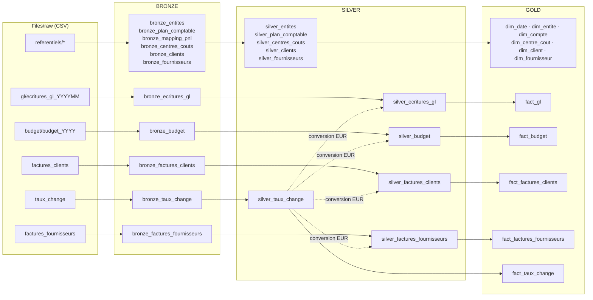

# 03 — Modèle de données

## 1. Lignage

## 2. Tables Gold

### Dimensions

| Table | Clé | Colonnes principales |
|---|---|---|
| `dim_date` | `date_key` (yyyymmdd) | date, annee, trimestre, annee_trimestre, mois, mois_nom, mois_court, annee_mois, annee_mois_num, jour, jour_semaine, est_jour_ouvre, est_fin_de_mois, est_avant_arrete |
| `dim_entite` | `entite_key` | code_entite, nom_entite, pays, devise |
| `dim_compte` | `compte_key` | numero_compte, libelle_compte, compte_libelle, classe, nature, ligne_pnl, ordre_pnl, agregat, est_compte_resultat |
| `dim_centre_cout` | `cc_key` | code_cc, libelle_cc, departement, responsable |
| `dim_client` | `client_key` | code_client, raison_sociale, pays, secteur, segment, delai_paiement_jours, code_entite |
| `dim_fournisseur` | `fournisseur_key` | code_fournisseur, raison_sociale, pays, categorie, delai_paiement_jours, code_entite |

Chaque dimension métier contient un membre **-1 « Inconnu »** pour absorber les codes orphelins.

### Faits

| Table | Grain | Mesures stockées |
|---|---|---|
| `fact_gl` | ligne d'écriture | debit, credit, montant_devise, debit_eur, credit_eur, montant_eur (D−C), montant_pnl_eur (C−D) |
| `fact_budget` | entité × compte × CC × mois | budget_pnl_devise, budget_pnl_eur |
| `fact_factures_clients` | facture | montant_ht/tva/ttc, montant_ht_eur, montant_ttc_eur, est_ouverte, jours_retard, delai_reglement_jours, tranche_age |
| `fact_factures_fournisseurs` | facture | idem |
| `fact_taux_change` | mois × devise | taux_moyen_eur, taux_cloture_eur |

## 3. Hiérarchie du compte de résultat (`dim_compte`)

| ordre_pnl | ligne_pnl | agregat | Comptes |
|---|---|---|---|
| 10 | Chiffre d'affaires | Marge brute | 706000, 706100 |
| 20 | Coût des ventes | Marge brute | 604000, 607000 |
| 30 | Charges externes | EBITDA | 606100, 613200, 615000, 622600, 623000, 625100, 626000, 651000 |
| 40 | Charges de personnel | EBITDA | 641000, 645000 |
| 50 | Dotations aux amortissements | Résultat d'exploitation | 681100 |
| 60 | Résultat financier | Résultat avant impôt | 661100, 768000 |
| 70 | Impôt sur les sociétés | Résultat net | 695000 |
| 999 | Bilan | — | classes 1 à 5 |

Les sous-totaux sont cumulatifs : EBITDA = agrégats {Marge brute, EBITDA} ; Résultat d'exploitation = + {Résultat d'exploitation} ; etc.

## 4. Décisions de modélisation

| Sujet | Décision | Alternative écartée |
|---|---|---|
| Signe | 2 colonnes : `montant_eur` (D−C, logique comptable) et `montant_pnl_eur` (C−D, logique lecture P&L) | Inverser le signe en DAX → mesures plus complexes |
| Devise | Conversion au taux moyen mensuel en Silver | Conversion dynamique en DAX → lent, incompatible avec agrégations simples |
| Mois futurs du budget | Dernier taux connu | Taux budget figé (nécessite une source supplémentaire) |
| Dates de factures | Clés + colonnes `date` dans le fait | Clés seules → mesures « à date » impossibles sans relation |
| Balance âgée | Tranche calculée en Gold à la date d'arrêté | Calcul DAX dynamique → plus lourd ; possible en v2 |
