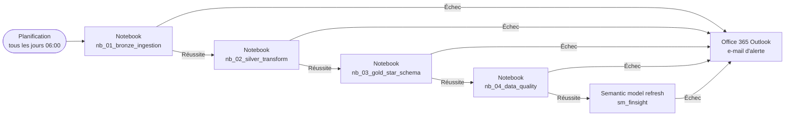

# Pipeline `pl_finsight_daily`

Orchestration quotidienne de la chaîne médaillon. À créer dans le workspace (tâche **FS-61**) :
*Nouveau → Data pipeline → `pl_finsight_daily`*.

## Activités

| # | Nom | Type | Paramètres | Délai / tentatives |
|---|---|---|---|---|
| 1 | `Bronze` | Notebook → `nb_01_bronze_ingestion` | `batch_id` = `@pipeline().RunId` | 30 min / 1 retry |
| 2 | `Silver` | Notebook → `nb_02_silver_transform` | — | 30 min / 1 retry |
| 3 | `Gold` | Notebook → `nb_03_gold_star_schema` | `date_arrete` = `@formatDateTime(adddays(utcNow(), -1), 'yyyy-MM-dd')` *(en prod ; laisser la valeur par défaut avec les données de démo)* | 30 min / 1 retry |
| 4 | `Qualite` | Notebook → `nb_04_data_quality` | — | 15 min / 0 retry |
| 5 | `Refresh modele` | Semantic model refresh → `sm_finsight` | — | 15 min |
| 6 | `Alerte` | Office 365 Outlook | Objet : `[FinSight] Échec @{pipeline().PipelineName}` ; corps : `@{pipeline().RunId}` | — |

> En Direct Lake, le « refresh » du modèle est un simple **recadrage** (*framing*) sur la dernière version des tables Delta :
> il dure quelques secondes. Si l'option *Garder vos données Direct Lake à jour* est activée sur le modèle, l'activité 5 est facultative.

## Paramètres des notebooks

Pour que le pipeline puisse passer des valeurs, la première cellule de code de `nb_01` et `nb_03` doit être marquée
comme **cellule de paramètres** (menu `…` de la cellule → *Toggle parameter cell*). C'est déjà le cas dans les fichiers
du dépôt (bloc `PARAMETERS CELL`).

## Planification

*Accueil → Planifier* : Quotidien, 06:00, fuseau (UTC+01:00) Paris. Activer.

## Gabarit JSON

[`pl_finsight_daily.template.json`](pl_finsight_daily.template.json) décrit la même logique au format de définition
des pipelines Fabric. Les identifiants `<WORKSPACE_ID>` / `<NOTEBOOK_ID_*>` sont propres à chaque tenant :
la création via l'interface reste la méthode recommandée ; le JSON sert de référence (onglet *Afficher → Code JSON*).
