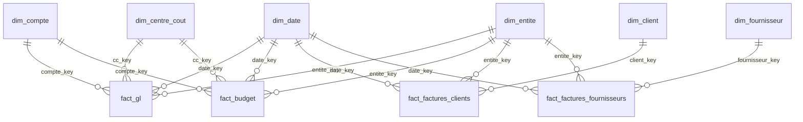

# Spécification du modèle sémantique `sm_finsight`

- **Mode de stockage** : Direct Lake sur le Lakehouse `lh_finsight`
- **Tables** : uniquement les tables du schéma **`gold`** (`dim_*`, `fact_*`) — ne rien inclure des schémas `bronze` / `silver`, ni `gold.dq_resultats`.
- Les noms de tables dans le modèle restent `dim_*` / `fact_*` (sans préfixe de schéma) : les mesures DAX n'ont pas à changer.

## 1. Tables à inclure

| Table | Type | Grain |
|---|---|---|
| `dim_date` | Dimension (table de dates) | 1 ligne / jour, 2024-01-01 → 2026-12-31 |
| `dim_entite` | Dimension | 1 ligne / filiale |
| `dim_compte` | Dimension | 1 ligne / compte comptable |
| `dim_centre_cout` | Dimension | 1 ligne / centre de coûts |
| `dim_client` | Dimension | 1 ligne / client |
| `dim_fournisseur` | Dimension | 1 ligne / fournisseur |
| `fact_gl` | Fait | 1 ligne / ligne d'écriture comptable |
| `fact_budget` | Fait | entité × compte × centre de coûts × mois |
| `fact_factures_clients` | Fait | 1 ligne / facture client |
| `fact_factures_fournisseurs` | Fait | 1 ligne / facture fournisseur |

`fact_taux_change` est optionnelle (analyse des taux), sans relation obligatoire.

## 2. Relations (toutes plusieurs-à-un, filtrage unidirectionnel)

> Créées automatiquement par le notebook `nb_05_semantic_model` (ou le script [`sm_finsight.tmdl`](sm_finsight.tmdl)).

| De (plusieurs) | Vers (un) | Active |
|---|---|---|
| `fact_gl[date_key]` | `dim_date[date_key]` | ✅ |
| `fact_gl[entite_key]` | `dim_entite[entite_key]` | ✅ |
| `fact_gl[compte_key]` | `dim_compte[compte_key]` | ✅ |
| `fact_gl[cc_key]` | `dim_centre_cout[cc_key]` | ✅ |
| `fact_budget[date_key]` | `dim_date[date_key]` | ✅ |
| `fact_budget[entite_key]` | `dim_entite[entite_key]` | ✅ |
| `fact_budget[compte_key]` | `dim_compte[compte_key]` | ✅ |
| `fact_budget[cc_key]` | `dim_centre_cout[cc_key]` | ✅ |
| `fact_factures_clients[date_key]` *(date facture)* | `dim_date[date_key]` | ✅ |
| `fact_factures_clients[date_paiement_key]` | `dim_date[date_key]` | ❌ inactive (USERELATIONSHIP) |
| `fact_factures_clients[entite_key]` | `dim_entite[entite_key]` | ✅ |
| `fact_factures_clients[client_key]` | `dim_client[client_key]` | ✅ |
| `fact_factures_fournisseurs[date_key]` | `dim_date[date_key]` | ✅ |
| `fact_factures_fournisseurs[date_paiement_key]` | `dim_date[date_key]` | ❌ inactive |
| `fact_factures_fournisseurs[entite_key]` | `dim_entite[entite_key]` | ✅ |
| `fact_factures_fournisseurs[fournisseur_key]` | `dim_fournisseur[fournisseur_key]` | ✅ |

## 3. Paramétrage des colonnes

| Action | Colonnes |
|---|---|
| **Décourager les mesures implicites** | Propriété du modèle → Activé (obligatoire pour le groupe de calcul) |
| **Marquer comme table de dates** | `dim_date`, colonne `date` |
| **Trier par colonne** | `dim_date[mois_nom]` par `mois` · `dim_date[mois_court]` par `mois` · `dim_date[annee_mois]` par `annee_mois_num` · `dim_date[jour_semaine]` par `jour_semaine_num` · `dim_compte[ligne_pnl]` par `ordre_pnl` · `fact_factures_clients[tranche_age]` et `fact_factures_fournisseurs[tranche_age]` par `tranche_age_ordre` |
| **Masquer** | toutes les colonnes `*_key`, `debit`, `credit`, `montant_devise`, `montant_eur`, `montant_pnl_eur`, `budget_pnl_*`, `montant_*_eur`, `tranche_age_ordre`, `ordre_pnl`, `annee_mois_num`, `jour_semaine_num` (on expose des **mesures**, pas des colonnes numériques) |
| **Résumer par : Aucun** | `annee`, `mois`, `jour`, `num_ligne`, `jours_retard`, `delai_*` |
| **Catégorie de données** | `dim_entite[pays]`, `dim_client[pays]` → Pays/Région |
| **Hiérarchies** | `dim_date` : Année → Trimestre → Mois → Date · `dim_compte` : Agrégat → Ligne P&L → Compte · `dim_centre_cout` : Département → Centre de coûts |

## 4. Mesures, descriptions, dossiers et formats

Tout est défini dans [`generate_tmdl.py`](generate_tmdl.py) (source unique) qui produit le notebook
[`nb_05_semantic_model`](../../fabric/workspace/nb_05_semantic_model.Notebook/notebook-content.py) (application recommandée)
et le script équivalent [`sm_finsight.tmdl`](sm_finsight.tmdl).
Chaque mesure a une **description** (visible au survol dans le volet Données), un **dossier** et un **format**.
Les mesures sont rangées dans leur table de faits (Direct Lake n'autorise pas de table de mesures calculée).

| Dossier | Mesures |
|---|---|
| 1. Compte de résultat | Réel, CA, Coût des ventes, Marge brute, Charges externes, Charges de personnel, EBITDA, Résultat d'exploitation, Résultat net, Montant P&L |
| 1. Compte de résultat \\ Ratios | Marge brute %, EBITDA %, Résultat net %, Personnel % CA |
| 2. Budget | Budget, CA Budget, EBITDA Budget, Résultat net Budget, Budget à date, Écart budget (à date), Écart budget %, Taux de réalisation CA, indicateur |
| 3. Temps | CA N-1 (raccourci pour les graphiques combinés) — le reste passe par le groupe de calcul |
| 4. Créances clients | CA facturé TTC, Encours clients (échu), % Encours échu, DSO, Encours à l'arrêté, Nb factures ouvertes, Retard moyen, Encaissements clients |
| 5. Dettes fournisseurs | Achats TTC, Encours fournisseurs, DPO, Décaissements fournisseurs |
| 6. Trésorerie | Trésorerie, Variation, Entrées, Sorties, BFR clients - fournisseurs |
| 9. Utilitaires | Date d'arrêté, Date de référence, Titre rapport, Libellé période |

## 5. Groupe de calcul « Intelligence temporelle »

Plutôt que de dupliquer chaque mesure en YTD / N-1 / variation (≈ 40 mesures), un **groupe de calcul** applique
la variante temporelle à **n'importe quelle mesure** : `[CA]`, `[EBITDA %]`, `[Écart budget à date]`, `[DSO (jours)]`…

| Élément (colonne `Période`) | Calcul | Format |
|---|---|---|
| Période | valeur de la période filtrée (défaut) | format de la mesure |
| YTD | `DATESYTD` | format de la mesure |
| N-1 | `SAMEPERIODLASTYEAR` | format de la mesure |
| YTD N-1 | `DATESYTD(SAMEPERIODLASTYEAR())` | format de la mesure |
| Var N-1 | N − N-1 | format de la mesure |
| Var N-1 % | (N − N-1) / \|N-1\| | `+0.0 %` (format dynamique) |
| 12 mois glissants | `DATESINPERIOD(-12, MONTH)` | format de la mesure |

**Utilisation dans le rapport**
- Matrice : mettre `Intelligence temporelle[Période]` en colonnes et une ou plusieurs mesures en valeurs.
- Carte KPI « CA YTD » : mesure `CA` + filtre du visuel `Période = YTD`.
- Dans une autre mesure : `CALCULATE ( [CA], 'Intelligence temporelle'[Période] = "N-1" )` (ex. `[CA N-1]`).
- Les mesures texte / date (`Titre rapport`, `Date d'arrêté`…) sont protégées : le groupe les renvoie inchangées.

## 6. Bonnes pratiques Direct Lake appliquées

- Pas de colonnes calculées ni de tables calculées (non supportées / provoquent un fallback) : tout est calculé en Gold.
- Clés entières, colonnes peu nombreuses, V-Order + `OPTIMIZE` sur les tables Gold.
- Vérifier l'absence de fallback DirectQuery : *Paramètres du modèle → Direct Lake behavior = Direct Lake only* pendant les tests.
